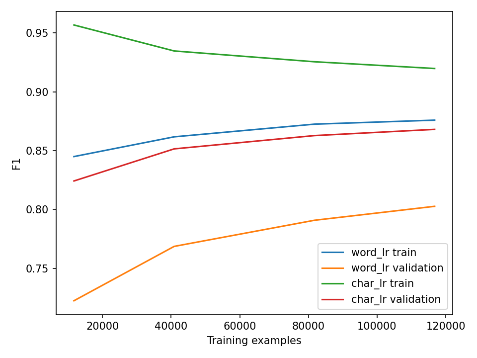
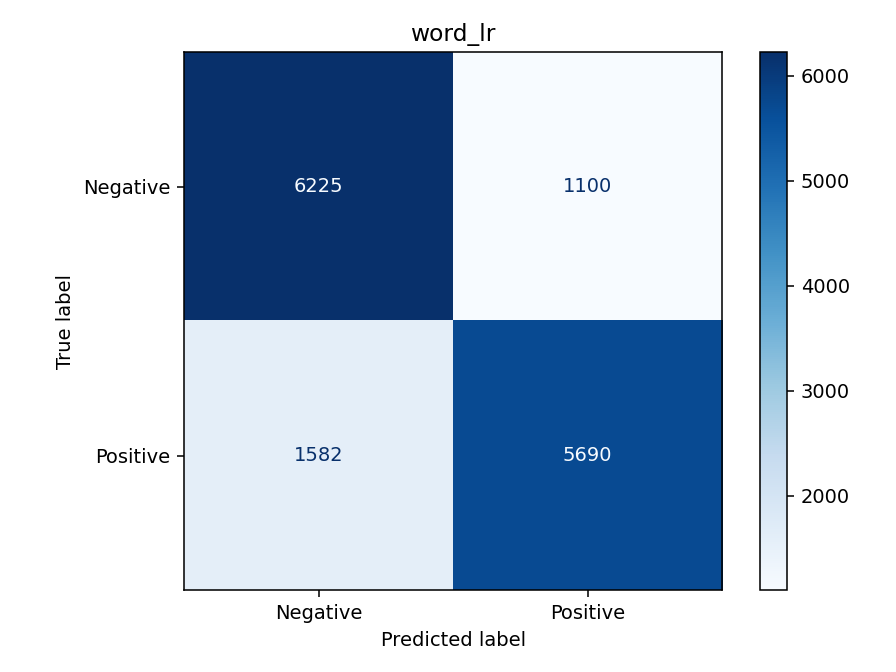

# Review Insight AI
영화·게임 리뷰 감성 및 불만 유형 분석 서비스

## 0. 프로젝트 정보
학번: 202335217 / 이름: 김서윤. 개인 기말 프로젝트.
GitHub URL: https://github.com/030217zerogirl-lang/review-insight-ai-202335217 . Demo URL: https://030217zerogirl-lang.github.io/review-insight-ai-202335217/ . Public 저장소와 공개 정적 데모를 배포했다. 실제 브라우저 조작 검증은 제어 도구 중단으로 완료하지 못했다.
현재 완성 범위: 직접 학습한 감성 모델 2개, 실제 가중치 기반 Streamlit 앱, 약한 지도 영화 불만 모델, 실행 결과 노트북과 제출 PDF/ZIP.
미완성: Transformer GPU 학습, 사람 검수 정답 기반 불만 모델 평가, 게임 전용 학습, 실제 화면 캡처 3장과 브라우저 검증.

## 1. 문제 정의
Who: 영화·게임 이용자와 콘텐츠 운영자. What: 리뷰의 전체 만족도와 부분적 불만을 함께 파악한다. When: 이용 후 리뷰를 쓰거나 여러 리뷰에서 개선 우선순위를 정할 때. Why: 단순 긍정부정 비율만으로는 구체적 개선점을 알기 어렵기 때문이다.
차별성: 전체 감성이 긍정이어도 다중 레이블 불만 분석을 실행한다. 영화 6개·게임 7개 범주를 정의하고 문장별 재예측을 보조 정보로 제공한다. 게임 불만은 모델이 없어 현재 제공하지 않는다.
정량 목표: 감성 테스트 긍정 클래스 F1 ≥ 0.80. 불만은 독립 gold test 범주별 양성 30건 이상 확보 후 Micro/Macro F1 목표를 확정한다. 현재 불만 F1은 측정할 수 없다.

## 2. 데이터
출처: Lucy Park, NSMC 원본 https://github.com/e9t/nsmc . 원본 README의 CC0 1.0 표기를 확인했다. HF 카드와 라이선스 표기가 달라 원본 출처를 기준으로 기록한다. 자세한 검증 기록은 docs/data_sources.md에 있다.
기존 과제 폴더의 공식 ratings_train.txt(150,000행)를 재사용했다. 원본 공식 test 50,000행은 사용하지 않았다. 원본 파일 SHA-256: e03b7d14e9e41be8d464a28057cd25d7396c53e67aa7fd5f7e552c59b0ee2940.
결측 제거 후 149,995행, 정규화·중복·상충 정답 제거 후 145,962행. 정확한 각 분할과 클래스 분포: reports/data_audit.json.
구성: {"train": {"size": 116769, "class_counts": {"0": 58599, "1": 58170}}, "validation": {"size": 14596, "class_counts": {"0": 7325, "1": 7271}}, "test": {"size": 14597, "class_counts": {"0": 7325, "1": 7272}}}
선정 이유: 한국어 실사용 리뷰이고 이진 감성 정답이 있어 CPU 모델 비교에 적합하다. 다만 단문·영화 편향으로 게임 일반화는 검증되지 않았다.
불만: NSMC에 속성 정답이 없으므로 감성 train에 한해서 자동 약한 레이블을 생성하여 OVR 분류기를 실제 학습했다. 수동 정답 자료가 아니고 다른 모델이나 규칙과의 일치율을 정확도라고 보고하지 않는다. data/annotation_queue.csv와 docs/annotation_guidelines.md로 사람 검수를 준비했다.

## 3. 데이터 전처리
src/core.py의 clean: (1) NFKC 유니코드·HTML 엔티티 정규화, (2) HTML 태그·URL 제거, (3) 반복 느낌표·물음표 축약, (4) 공백 정리. 부정어와 한국어 문자·이모티콘 정보는 불필요하게 삭제하지 않았다.
전·후 30개 실제 변경 사례는 reports/preprocessing_examples.csv에 저장했다. 예: 전각 A, HTML 태그·링크, 반복 느낌표는 테스트에서 'A 좋다 !!'로 변환됨을 확인했다.
동일 정규화 텍스트의 상충 정답 160개 텍스트를 제거하고 중복을 제거한 후 80:10:10 층화 분할, random seed=42. 세 파티션 텍스트 교집합 0을 tests/verify.py에서 확인했다.
TF-IDF는 train에만 fit하고 validation으로 C와 최종 모델을 선택한 뒤 고정 테스트를 평가했다. 동일 데이터로 기존 수업 과제를 수행한 이력이 있어 완전히 새로 수집한 외부 검증으로 해석하지 않는다.

## 4. 모델
베이스라인 word_lr: 단어 TF-IDF(1~2그램)+Logistic Regression. 해석 가능하고 CPU에서 빠르게 학습 가능하다.
개선 모델 char_lr: 문자 TF-IDF(2~5그램)+Logistic Regression. 한국어 띄어쓰기·어미·신조어에 대응하도록 문자 문맥을 사용한다. 사전 학습 Transformer는 아니며 두 모델 모두 NSMC로 직접 학습했다.
공통: max_features=100000, min_df=3, sublinear_tf=True, solver=liblinear, max_iter=300, C 후보 0.5/2.0, seed=42. 정확한 선택값·시간·행 수·환경은 reports/training_environment.json과 comparison.csv에 있다. 표의 training_seconds는 전체 전처리·학습곡선 추가 실행 시간을 제외한 후보 탐색 시간이다.
불만 모델: 문자 TF-IDF+OneVsRest Logistic Regression, C=2, class_weight=balanced, threshold=0.5, 다중 레이블. 가중치는 models/aspect_movie.joblib. 규칙은 오직 약한 학습 레이블 생성에 사용하고 서비스 추론은 학습된 분류기로 수행한다. '기타' 약한 규칙은 일반적 불만과 다른 범주의 공존을 허용하여 정식 라벨 정의와 차이가 있다.
Transformer: scripts/train_transformer.py와 notebooks/02_colab_transformer.ipynb 제공. KLUE-BERT(CC-BY-SA-4.0), lr=2e-5, epochs=3, max_length=96, batch=16, seed=42, validation F1 checkpoint 선택. GPU 학습은 미실행으로 가중치·성능이 없다.

## 5. 평가 결과
같은 테스트셋에서 직접 평가한 결과다. F1·Precision·Recall은 긍정 클래스(1) 기준이다. 최종 모델 char_lr는 테스트를 보기 전 validation F1로 선정했다. 비교 대상 두 감성 모델은 같은 학습·검증·테스트 행을 사용했다.

| model | accuracy | precision | recall | f1 | validation_f1 | training_seconds |
| --- | --- | --- | --- | --- | --- | --- |
| word_lr | 0.8163 | 0.8380 | 0.7825 | 0.8093 | 0.8026 | 18.5806 |
| char_lr | 0.8699 | 0.8729 | 0.8648 | 0.8688 | 0.8680 | 85.8519 |


이 곡선은 epoch 곡선이 아닌 학습 표본 수별 learning curve다. 각 지점에서 TF-IDF부터 재학습했다. train/validation F1 격차로 과적합과 데이터 증가 효과를 관찰한다. Logistic Regression의 epoch별 loss를 생성했다고 주장하지 않는다.


오분류 사례(0=부정, 1=긍정):
- 원문: 뷁!! / 정답 0, 예측 1
- 원문: 희대의영화 천재감독 쿠엔틴 타란티노가,킬빌의여주인공 블랙맘바(우마 서먼 분)의 라이벌 엘르 드라이버를 어디서 캐스팅했는지,알수 있다.영화의절반은 캐스팅,캐스팅만 제대로 마치면,나머지 절반은 다 이루어진거나 마찬가지...흥행은 하늘에 맡기고...(웃음) / 정답 1, 예측 0
- 원문: 식상한면이 있었다 근데 왜 네이버에서 나의 영화평점을 자꾸 삭제하세요?? / 정답 0, 예측 1
- 원문: 앞뒤를 알고 영화에 배경을 알게되면 과연 평점이 이리 나올수 있을까 의문이 드네요 / 정답 0, 예측 1
- 원문: 저기요 ;;밑에분 보지도않고 잘알지도않고 ᄏᄏ뭐하는거?OOO ᄏᄏᄏᄏᄏ기대하겠습니당 / 정답 1, 예측 0
짧은 평가·반어·긍정어와 부정 문맥 혼재는 분석 후보다. 위 사례는 실제 오분류이며 각 원인은 추가 검수 없이 확정할 수 없다. 전체 50개 사례는 모델별 errors.csv에 있다.
불만 Macro F1, Micro F1, 범주별 F1: 미산출. 독립 사람 정답이 없으므로 정량적 성능을 주장할 수 없다. scripts/train_gold_aspects.py는 검수된 세 분할 CSV에 대해 두 모델을 비교하고 해당 지표·범주별 지원 수·다중 혼동행렬을 생성한다. 현재 이를 실행한 결과는 없다.

## 6. 서비스 프로토타입
Streamlit의 리뷰 분석, CSV 대시보드, 프로젝트 소개 화면을 구현했다. models/manifest.json이 지정한 감성 joblib과 불만 joblib을 로드한다. 가중치가 없으면 오류를 표시하고 임의 결과로 대체하지 않는다.
사용 안내: 영화/게임 선택 → 리뷰 입력 → 분석. 긍정 모델 확률 40~60%면 불확실성을 안내한다. 확률은 보정되지 않은 모델 출력이다. 영화 불만은 전체 감성과 무관하게 항상 분석한다. 게임은 도메인 외 감성 실험이며 불만 모델은 미학습이라고 표시한다.
문장별 근거 보조 기능은 문장을 같은 분류기로 재예측한다. 키워드 매칭을 AI 판단 근거로 제시하지 않으며 인과적 설명이라고 주장하지 않는다.
CSV: review 또는 text 열, UTF-8/CP949, 1~1,000행, 5MB 이하. 감성 비율·카테고리 빈도·대표 리뷰·결과 다운로드를 제공한다. 현재 '자주 언급되는 문제'는 범주 빈도로 요약하며 개별 세부 주제 군집화는 구현하지 않았다. 업로드 리뷰는 디스크에 저장하지 않는다.
실행 검증: 실제 가중치 추론, 분할 교집합, 빈 값·길이 검사, Streamlit 리뷰/소개/대시보드 초기화/게임 경고를 확인했다. CSV 처리 코드는 Node DOM 대체 객체 기반 단위 검증을 추가했다(reports/static_handler_tests.json). 실제 브라우저 업로드 흐름은 제어 도구 중단으로 미검증이다.
로컬 검증 프로세스 관측 RSS: 227.1 MB. 모델 크기: {"aspect_movie.joblib": 3.226, "char_lr.joblib": 1.724, "word_lr.joblib": 0.963} MB. 클라우드 메모리 상한 보장을 의미하지 않는다.
실제 브라우저 화면 캡처 미확보. 충족으로 표시하지 않음.

## 7. 배포
플랫폼: GitHub Pages(공개 정적 데모), 로컬 Python Streamlit(원본 앱). 공개 URL: https://030217zerogirl-lang.github.io/review-insight-ai-202335217/ . 인증은 샌드박스 밖에서 재확인하니 유효했다. 직접 학습한 TF-IDF vocabulary/IDF/회귀 계수·절편을 JSON으로 변환하여 브라우저가 동일 수식으로 추론한다. Python 대 JavaScript 42개 리뷰의 최대 확률 차이 1.69e-8 미만. 보고서: reports/browser_model_parity.json. 공개 페이지·JS·모델 파일 HTTP 200과 공개 모델의 실제 예측은 tests/public_deployment.mjs로 검증했다. 실제 브라우저 렌더링·파일 선택·다운로드는 미검증이다. GitHub Pages는 Python 서버를 실행하지 않는다. Streamlit 원본 앱도 별도로 제공한다.
공식 배포 문서: https://docs.streamlit.io/deploy/streamlit-community-cloud/deploy-your-app . 무료 플랜 제한은 변경될 수 있어 배포 당일 공식 상태 문서를 확인해야 한다. 앱은 Transformer를 로드하지 않고 CPU TF-IDF 모델을 사용한다.
100MB 초과 모델·데이터를 ZIP 또는 GitHub에 넣지 않는다. KLUE 대형 가중치를 추후 만들면 라이선스와 모델 카드가 포함된 외부 저장소에 업로드하고 실제 링크를 기록한다. 현재 존재하지 않는 외부 링크는 없다.

## 8. 실행 방법
Python 3.12, Windows에서 실제 실행했다. requirements.txt는 서비스용, requirements-training.txt는 GPU 학습·문서용이다. 실행 위치는 review-insight-ai 폴더다.

```powershell
py -3.12 -m venv .venv
.venv\Scripts\Activate.ps1
python -m pip install -r requirements.txt
python -m streamlit run app.py
```

감성·약한 지도 모델 재학습: `python scripts/train.py`. 기존 수업 데이터가 없으면 공식 NSMC train을 다운로드하고 동일 split/seed로 학습한다. 시간·지표는 실행 환경에 따라 달라질 수 있다.
실행 검증: `python tests/verify.py`. Transformer: GPU에서 `python scripts/train_transformer.py --epochs 3 --batch-size 16`. 라벨 검수 후 다중 레이블 학습: `python scripts/train_gold_aspects.py reviewed.csv --domain movie`.
가중치: models/word_lr.joblib, models/char_lr.joblib, models/aspect_movie.joblib 및 manifest.json. 신뢰할 수 없는 joblib 파일을 로드하지 않는다. 출력 유지 노트북: notebooks/01_executed_results.ipynb. Colab 노트북은 미실행 상태를 명시했다.
README 기반 PDF·ZIP 재생성: `python scripts/build_submission.py`. PDF 생성 직전 작업 표시 명령은 제공된 개발 환경용이며 프로젝트 실행에는 필요하지 않다.
비밀값은 .gitignore로 제외하고 원문 강의 PDF를 공개 파일에 포함하지 않는다. 최종 파일 목록·크기와 검증은 reports/package_verification.json에 기록한다.

## 9. Lessons Learned
Plus 1: 기존 과제의 NSMC 파일을 발견하고 SHA-256을 기록해 출처가 추적되는 실제 학습 입력을 확보했다. Plus 2: 동일 분할로 단어/문자 모델을 비교해 validation 기준 선택과 테스트 평가를 분리했다.
Minus 1: 기존 .venv가 삭제된 Python 3.11 경로를 가리켜 그대로 실행할 수 없었다. Minus 2: 불만 정답 데이터가 없어 핵심 차별 기능의 사람 기준 성능을 검증하지 못했다. 약한 지도는 완전한 대안이 아니었다.
Interesting 1: 영화 감성과 불만은 다른 레이블 체계라 전체 감성이 긍정이어도 불만 분석이 필요했다. Interesting 2: NSMC 원본과 HF 카드의 라이선스 표기가 달라 배포 시 원본 확인과 출처 구분이 필요했다.
문제 → 원인 → 시도 → 결과: 기존 가상환경 실행 실패 → Python311 실행 파일 부재 → py -3.12로 실제 설치 경로 확인 및 전환 → NSMC 학습 스크립트 실행 성공.
문제 → 원인 → 시도 → 결과: PDF 텍스트 출력 UnicodeEncodeError → Windows cp949 콘솔이 특수 문자를 표현하지 못함 → -X utf8 지정 → 전체 과제 배점과 필수 요구사항 추출 성공.
문제 → 원인 → 시도 → 결과: 최신 PyTorch 설치 OSError → Windows 긴 설치 경로 제한이라는 pip 진단 → torch 2.5.1 안정 버전 설치 재시도 → 실제 최종 상태는 reports/dependency_status.json 확인. GPU 파인튜닝 성공으로 해석하지 않는다.
향후 데이터 개선: 두 명 검수와 불일치 합의로 영화·게임별 독립 gold test 구축, 작품 단위 분할과 카테고리별 양성 지원 수 확보. 모델 개선: KLUE-BERT GPU 파인튜닝 및 독립 gold 불만 다중 레이블 비교, calibration과 도메인 전이 평가. 서비스 개선: 게임 모델 확보 후 활성화, CSV 비동기 처리·메모리 캐시·배포 모니터링, 공개 URL 예측 회귀 점검.
개인 프로젝트의 코드 작성·실험 실행·문서 정리에 AI 개발 보조를 사용했다. 자동 레이블을 사람이 만든 정답으로 표시하지 않았으며 미완성 항목도 그대로 공개한다.

추가 문제 해결: 브라우저 제어 호스트 연결 실패와 안전한 URL 식별 실패로 자동 UI 검증이 중단되었다. 다른 브라우저 제어로 우회하지 않고, 학습 가중치를 정적 JSON으로 내보내 수치 일치·HTTP 공개 자산·코드 처리기 검증을 수행했다. 실제 화면 캡처를 만들었다고 주장하지 않았다. GitHub Pages 무료 정적 호스팅은 서버 모델 메모리 제약을 피하지만 첫 모델 다운로드 약 15MB와 브라우저 메모리 비용이 생긴다. 정확한 숫자는 reports/deployment.json에 있다. 향후 완전한 브라우저 실측과 모바일 성능 개선이 필요하다.
