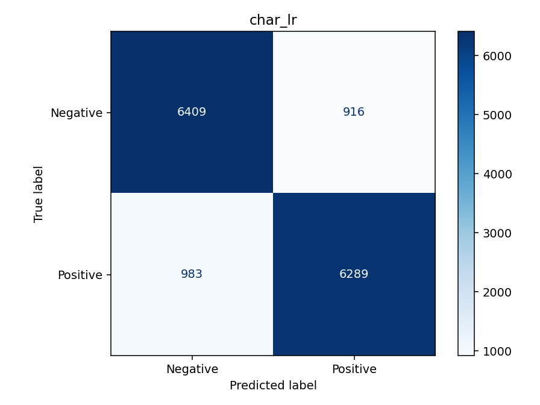

# Review Insight AI
영화·게임 리뷰 감성 및 불만 유형 분석

## 0. 프로젝트 정보
학번: 202335217 / 이름: 김서윤
GitHub: https://github.com/030217zerogirl-lang/review-insight-ai-202335217
공개 데모: https://030217zerogirl-lang.github.io/review-insight-ai-202335217/
개발 환경: Python 3.12, Windows, scikit-learn 1.5.2, Streamlit 1.40.2. GPU는 사용하지 않았다.
직접 학습한 두 감성 모델과 영화 불만 분류 모델을 사용한다. 로컬 앱은 Streamlit, 공개 데모는 같은 가중치를 변환한 JavaScript 추론 엔진으로 구성했다.

## 1. 문제 정의
Who: 영화·게임 리뷰를 읽는 이용자와 콘텐츠 운영자.
What: 전체 감성뿐 아니라 리뷰에서 불만이 제기된 요소를 파악한다.
When: 콘텐츠를 선택하거나 이용 후 의견을 정리하고, 여러 리뷰에서 개선 우선순위를 찾을 때 사용한다.
Why: 긍정부정 비율만으로는 연기·스토리·음악 중 무엇이 문제인지 구분하기 어렵기 때문이다.
차별점은 전체 만족도와 부분적인 불만을 분리한다는 점이다. 전체 감성이 긍정이어도 불만을 분석하고, 긍정·부정으로 예측한 절이 함께 있으면 혼합으로 표시한다.
감성 분류 정량 목표는 테스트 긍정 클래스 F1 0.80 이상이다. 불만 모델은 독립적으로 검수한 평가셋을 먼저 확보하고, 카테고리별 양성 30건 이상이 확보된 뒤 Micro/Macro F1 목표를 확정한다.

## 2. 데이터
NSMC 원본: https://github.com/e9t/nsmc . 작성자 Lucy Park. 원본 저장소의 라이선스 표기는 CC0 1.0이다. Hugging Face 카드의 표기가 달라 원본 자료의 출처와 조건을 구분해 기록했다(docs/data_sources.md).
기존 수업 과제 폴더에 보관된 공식 train 150,000행을 사용했다. 공식 test 50,000행은 사용하지 않았다. 결측 제거 후 149,995행, 정규화·중복·상충 레이블 제거 후 145,962행을 확보했다.

| 분할 | 리뷰 수 | 부정(0) | 긍정(1) |
|---|---|---|---|
| train | 116,769 | 58,599 | 58,170 |
| validation | 14,596 | 7,325 | 7,271 |
| test | 14,597 | 7,325 | 7,272 |

선정 이유는 한국어 실제 리뷰이며 이진 감성 정답이 있어 CPU 환경에서도 직접 학습·비교할 수 있다는 점이다. 단문·영화 중심 자료이므로 게임 일반화는 별도 검증이 필요하다. 기존 수업에서 같은 자료를 다룬 이력이 있으므로 새로 수집한 외부 검증 결과로 해석하지 않는다.
NSMC에는 불만 유형 정답이 없다. 감성 학습 파티션에서 범주·부정 표현 규칙으로 약한 레이블을 생성하고 별도의 다중 레이블 모델을 학습했다. 이 레이블은 사람 정답이 아니다. 수동 검수 지침은 docs/annotation_guidelines.md에 있다.
원본 파일 해시·규모·분포는 reports/data_audit.json, 불만 범주별 약한 레이블 수는 reports/aspect_training.json에서 확인할 수 있다.

## 3. 데이터 전처리
src/core.py의 clean 함수에 NFKC·HTML 엔티티 정규화, HTML 태그와 URL 제거, 반복 느낌표·물음표 축약, 공백 정리를 구현했다. 부정어를 일괄 삭제하지 않았다.
실제 전후 비교 30건은 reports/preprocessing_examples.csv에 저장했다. 테스트 예시: 'Ａ <b>좋다</b> https://a.b !!!!' → 'A 좋다 !!'.
정규화한 텍스트 기준으로 정답이 상충한 160개 텍스트를 제거하고 중복을 제거한 뒤, train/validation/test를 80:10:10, random seed 42로 층화 분할했다. 세 분할 사이 정규화 텍스트 교집합은 0이다.
TF-IDF는 train에만 fit했다. C와 최종 모델은 validation F1로 선택하고, 고정 테스트셋에서는 최종 지표만 산출했다.

## 4. 모델
베이스라인: 단어 TF-IDF(1~2그램) + Logistic Regression. 학습이 빠르고 단어 단위 특징을 기준으로 비교할 수 있다.
개선 모델: 문자 TF-IDF(2~5그램) + Logistic Regression. 한국어 어미·띄어쓰기 변화와 짧은 표현에 대응하도록 구성했다.
공통 설정: max_features=100000, min_df=3, sublinear_tf=True, max_iter=300, liblinear, C 후보 0.5/2.0, seed 42. 두 모델 모두 C=2.0을 선택했다. 후보 탐색 시간은 단어 약 18.6초, 문자 약 85.9초이며 추가 학습곡선 실행 시간은 제외한다. 환경·시간은 reports/training_environment.json에 기록했다.
불만 모델은 문자 TF-IDF(2~4그램) + OneVsRest Logistic Regression이다. C=2, class_weight=balanced, threshold=0.5이며 영화 6개 범주에 복수 레이블을 허용한다. 서비스 추론에는 저장한 가중치를 사용한다.
혼합 감성은 별도의 3클래스 학습 모델이 아니다. 문장부호와 '지만/는데/은데/으나' 등 대조 표현으로 절을 나눠 같은 이진 감성 모델로 재예측한다. 긍정 확률 0.60 이상인 절과 0.40 이하인 절이 함께 있으면 혼합으로 표시한다. 0.40~0.60의 전체 확률만으로 혼합이라고 판단하지 않는다.
불만은 부정으로 예측한 절의 분류 점수를 기준으로 표시해 긍정적으로 언급한 음악 등이 불만으로 섞이는 경우를 줄였다. 절 분리가 문맥을 잃거나 이진 모델이 절을 오분류하면 혼합·불만 결과도 틀릴 수 있다.
Transformer는 KLUE-BERT 파인튜닝 코드와 Colab GPU 노트북을 제공하지만 학습하지 않았다. 제공 설정은 epochs=3, batch_size=16, lr=2e-5, max_length=96, seed=42다. KLUE-BERT 라이선스는 CC-BY-SA-4.0이다. 게임 전용 감성·불만 모델도 아직 학습하지 않았다.

## 5. 평가 결과
두 감성 모델을 동일한 테스트 14,597행에서 평가했다. Precision/Recall/F1은 긍정 클래스 기준이다. 최종 모델은 테스트를 보기 전 validation F1이 높은 문자 모델로 선택했다.

| 모델 | Accuracy | Precision | Recall | F1 | Validation F1 |
|---|---|---|---|---|---|
| 단어 TF-IDF + LR | 0.8163 | 0.8380 | 0.7825 | 0.8093 | 0.8026 |
| 문자 TF-IDF + LR | 0.8699 | 0.8729 | 0.8648 | 0.8688 | 0.8680 |

문자 모델의 테스트 F1은 0.8688로 목표 0.80을 달성했다. 이 수치는 원래 이진 분류 성능이며 혼합 감성 판정이나 불만 분류의 성능이 아니다.

곡선은 epoch가 아닌 학습 표본 수별 learning curve다. 각 지점에서 TF-IDF와 분류기를 다시 학습했다. 학습·검증 격차는 남아 있으며 문자 모델의 검증 F1이 더 높았다.

문자 모델은 부정 7,325개 중 6,409개, 긍정 7,272개 중 6,289개를 맞혔다. 짧은 표현 '뷁!!'은 정답 부정을 긍정으로 잘못 예측했다. '식상한면이 있었다 근데 왜 네이버에서 나의 영화평점을 자꾸 삭제하세요??'도 정답 부정을 긍정으로 예측했다. 짧은 표현과 감정·상황 설명이 섞인 문장의 한계를 확인했다. 전체 사례는 reports/char_lr_errors.csv에 있다.
불만 Micro F1·Macro F1·범주별 F1은 독립 사람 정답이 없어 산출하지 않았다. 혼합 감성도 정답셋 기준 성능을 평가하지 않았다. tests/mixed_reviews.py의 사례 점검은 회귀 검증이며 정량적인 일반화 성능을 뜻하지 않는다.
혼합 사례: '음악은 좋은데 스토리는그닥..' → 혼합, '음악은 좋은데' 긍정 확률 0.6346, '스토리는그닥..' 긍정 확률 0.0640, 불만 '스토리 및 전개'. 전체 문장의 이진 긍정 확률 0.1286은 혼합 확률과 구분한다.

## 6. 서비스 프로토타입
기능은 단일 리뷰 분석, 영화/게임 선택, 절별 감성, 다중 레이블 불만, CSV 대시보드와 결과 다운로드다. models/manifest.json의 감성 가중치와 영화 불만 가중치를 읽는다. 모델이 없거나 로딩에 실패하면 오류를 표시한다.
리뷰 입력 → 분석 실행 → 긍정/부정/혼합 및 절별 결과 확인 순서로 사용한다. 게임을 선택하면 영화 모델의 도메인 외 감성 예측임을 표시하고 게임 불만은 미학습으로 안내한다.
CSV는 review 또는 text 열, UTF-8/CP949, 최대 1,000행·5MB를 지원한다. 긍정·부정·혼합 비율, 불만 카테고리 빈도, 대표 리뷰를 표시하고 절별 결과를 포함한 CSV를 내려받을 수 있다. 리뷰는 서버에 저장하지 않는다.
절별 결과는 보조 정보이며 인과적 근거 추출이 아니다. 불만 점수는 자동 약한 레이블 모델의 출력이며 보정된 정확도를 뜻하지 않는다.
모델 추론·혼합 사례·입력 오류·Streamlit 화면 초기화·CSV 처리기 검증 결과는 reports/runtime_checks.json, mixed_review_checks.json, static_handler_tests.json에 있다. CSV 처리기는 DOM 대체 객체로 확인했으며 실제 브라우저 파일 선택·렌더링·다운로드 검증과는 구분한다.
서비스 화면 캡처 3장은 아직 확보하지 못했다. 제출 전에 단일 리뷰 결과, 혼합 리뷰 결과, CSV 대시보드의 실제 화면을 추가해야 한다.

## 7. 배포
공개 데모: https://030217zerogirl-lang.github.io/review-insight-ai-202335217/
GitHub Pages에서 정적 웹서비스를 제공한다. Python 학습 가중치의 vocabulary·IDF·회귀 계수·절편을 JSON으로 내보내고 브라우저에서 TF-IDF와 회귀식을 계산한다. 외부 추론 API는 사용하지 않는다. 원래 Streamlit 앱은 로컬 또는 별도 Python 호스팅에서 실행할 수 있다.
Python/JavaScript 간 45개 리뷰의 감성·불만 출력과 확률을 비교했다. 확률 최대 차이는 1.68e-08이며 결과는 reports/browser_model_parity.json에 있다. 공개 파일 HTTP 응답과 공개 가중치 추론은 reports/deployment.json에 기록했다. 실제 브라우저 조작 검증은 미완료다.
정적 호스팅은 서버 모델 메모리 부담이 없지만 첫 모델 다운로드 약 15MB와 클라이언트 계산 비용이 있다. 로컬 검증 프로세스 RSS는 약 261.0MB였고 압축 모델 총합은 약 5.9MB다. 클라우드·모바일의 메모리 보장을 의미하지 않는다.
100MB 초과 데이터·가중치는 포함하지 않는다. 원본 수업 자료, 비밀값과 개발용 임시 파일도 제출하지 않는다.

## 8. 실행 방법
실행 위치는 압축을 푼 review-insight-ai 폴더다. CPU에서 기존 가중치로 실행할 수 있다.

```powershell
py -3.12 -m venv .venv
.venv\Scripts\Activate.ps1
python -m pip install -r requirements.txt
python -m streamlit run app.py
```

재학습: python scripts/train.py. 기존 데이터가 없으면 NSMC 공식 train을 내려받고 동일한 seed와 비율로 분할한다.
혼합 사례 점검: python tests/mixed_reviews.py. 전체 앱 점검: python tests/verify.py. 데이터 분할 파일이 없으면 테스트에서 원본을 내려받아 준비하므로 네트워크가 필요하다.
개발·GPU 학습 의존성: requirements-training.txt. GPU 학습: python scripts/train_transformer.py --epochs 3 --batch-size 16. 검수 정답 확보 후 불만 모델 비교: python scripts/train_gold_aspects.py reviewed.csv --domain movie.
가중치는 models/word_lr.joblib, models/char_lr.joblib, models/aspect_movie.joblib에 있다. 신뢰할 수 없는 joblib 파일은 로드하지 않는다.
notebooks/01_executed_results.ipynb는 출력이 유지된 결과 검증 노트북이다. 실제 모델 학습은 scripts/train.py에서 수행했다. notebooks/02_colab_transformer.ipynb는 미실행 GPU 학습 노트북이다.
포트폴리오 PDF 재생성: python scripts/build_portfolio.py. Windows 맑은 고딕 또는 Linux NanumGothic 글꼴이 필요하다.

## 9. Lessons Learned
Plus 1: 기존 NSMC 원본의 해시를 기록해 학습 입력을 추적할 수 있었다. Plus 2: 같은 분할을 사용하고 검증 F1로 선택해 문자 모델의 개선을 객관적으로 비교할 수 있었다.
Minus 1: 영화 리뷰에는 감성 정답만 있어 불만 성능을 사람 정답으로 검증하지 못했다. Minus 2: 게임 전용 데이터와 GPU 실험이 없어 두 도메인 전체를 완성하지 못했다.
Interesting 1: 한 리뷰에서 음악 칭찬과 스토리 불만이 동시에 나타나 전체 이진 감성만으로는 의미가 손실됐다. Interesting 2: 긍정 문장도 약한 지도 불만 모델에서 높은 점수를 받는 사례가 있어 감성과 불만을 함께 확인할 필요가 있었다.
문제 → 원인 → 시도 → 결과: '음악은 좋은데 스토리는그닥..'이 전체 부정으로만 표시됨 → 이진 모델이 리뷰 전체를 한 번에 평가함 → 대조 절 분리와 절별 재예측 추가 → 혼합으로 표시하고 스토리 불만만 남기는 사례 검증 통과.
문제 → 원인 → 시도 → 결과: '음악과 영상 모두 정말 훌륭하다.'에 불만이 표시됨 → 약한 레이블 분류기가 주제 표현 자체에 반응함 → 부정 절이 감지된 경우에 불만을 표시하도록 보완 → 해당 긍정 사례의 불만 표시 제거. 이는 사례 수정이며 정답셋 성능 개선을 입증한 것은 아니다.
문제 → 원인 → 시도 → 결과: Streamlit이 설정을 읽지 못함 → UTF-8 BOM이 TOML 첫 키에 포함됨 → BOM 없는 UTF-8로 저장 → 앱 시작과 자동 화면 검증 통과.
데이터 개선: 두 명의 독립 검수와 합의로 영화·게임 불만 정답을 구축하고 작품 단위 중복을 통제한다. 모델 개선: KLUE-BERT와 사람 정답 기반 다중 레이블 모델을 같은 분할에서 비교하고 혼합 감성 정답·확률 보정을 추가한다. 서비스 개선: 실제 화면 검증·캡처와 모바일 속도 측정을 완료하고 모델 캐시·다운로드 크기를 개선한다.
